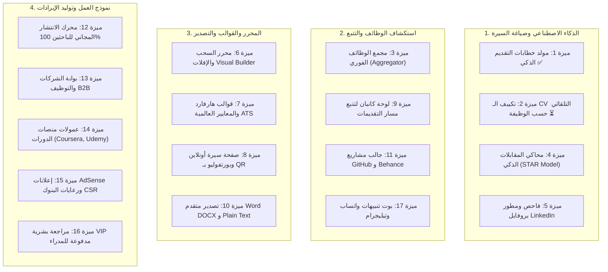

# 🚀 خارطة طريق ميزات JobMatch AI الشاملة (17 ميزة استراتيجية)

> **الإصدار:** 2.0 (أكتوبر 2026)  
> **حالة المشروع الحالية:** اكتمال الميزة 1 بنسبة 100% (17/17 مرحلة مع 208+ اختبار ناجح)  
> **المرجع التقني الكامل:** [JobMatch_Antigravity_289_Prompts.md](file:///c:/Users/dell/Desktop/freelance/top-projects/AI-Resume/JobMatch_Antigravity_289_Prompts.md) (إجمالي 289 برومبت مقسمة إلى 17 مرحلة لكل ميزة)

---

## 📊 جدول الحالة العامة للميزات الـ 17

| # | اسم الإضافة | الفئة | عدد المراحل | الحالة | الأولوية |
|---|---|---|---|---|---|
| **01** | [مولد خطابات التقديم الذكي (AI Cover Letter)](#feature-1) | الذكاء الاصطناعي | 17 مرحلة | ✅ **مكتمل 100%** | أساسي |
| **02** | [التوليد والتعديل التلقائي الذكي للـ CV (Auto-Tailored CV)](#feature-2) | تخصيص السيرة | 17 مرحلة | ⏳ **المرحلة التالية** | قصوى |
| **03** | [محرك جلب وتجميع الوظائف المباشر (Job Aggregator)](#feature-3) | استكشاف الوظائف | 17 مرحلة | 📋 مجدول | عالية |
| **04** | [محاكي المقابلات الشخصية الذكي (AI Mock Interviewer)](#feature-4) | التدريب والتأهيل | 17 مرحلة | 📋 مجدول | عالية |
| **05** | [فاحص ومطور ملف LinkedIn الاحترافي (LinkedIn Optimizer)](#feature-5) | الهوية المهنية | 17 مرحلة | 📋 مجدول | متوسطة |
| **06** | [محرر بصري بالسحب والإفلات (Visual Drag & Drop Builder)](#feature-6) | تجربة الاستخدام | 17 مرحلة | 📋 مجدول | عالية |
| **07** | [حزمة قوالب عالمية معتمدة (Harvard & Modern ATS Gallery)](#feature-7) | التصميم والقوالب | 17 مرحلة | 📋 مجدول | عالية |
| **08** | [بورتفوليو أونلاين بـ QR Code ورابط ويب تفاعلي](#feature-8) | النشر والمشاركة | 17 مرحلة | 📋 مجدول | متوسطة |
| **09** | [نظام تتبع طلبات التوظيف (Job Application Kanban Tracker)](#feature-9) | إدارة التقديمات | 17 مرحلة | 📋 مجدول | عالية |
| **10** | [تصدير متقدم بصيغ متعددة (Word docx, Plain Text, High-Res PDF)](#feature-10) | التصدير والتوافق | 17 مرحلة | 📋 مجدول | عالية |
| **11** | [جالب مشاريع GitHub و Behance التلقائي (Dev & Creative Scraper)](#feature-11) | استيراد الإنجازات | 17 مرحلة | 📋 مجدول | متوسطة |
| **12** | [نموذج المنصة المجانية 100% للباحثين عن عمل (100% Free Model)](#feature-12) | النمو والانتشار | 17 مرحلة | 📋 مجدول | قصوى |
| **13** | [بوابة الشركات وأصحاب الأعمال والوظائف المميزة (B2B Portal)](#feature-13) | توليد الأرباح (B2B) | 17 مرحلة | 📋 مجدول | قصوى |
| **14** | [التسويق بالعمولة للكورسات والدورات التدريبية (EdTech Affiliate)](#feature-14) | تسويق بالعمولة | 17 مرحلة | 📋 مجدول | متوسطة |
| **15** | [شبكة إعلانات جوجل والرعايات المؤسسية (AdSense & CSR)](#feature-15) | دخل سلبي | 17 مرحلة | 📋 مجدول | متوسطة |
| **16** | [خدمة الاستشارة والمراجعة البشرية VIP (Human Review)](#feature-16) | خدمات مميزة | 17 مرحلة | 📋 مجدول | متوسطة |
| **17** | [تنبيهات الفرص الذكية عبر واتساب وتيليجرام (Instant Alerts)](#feature-17) | الإشعارات اللحظية | 17 مرحلة | 📋 مجدول | عالية |

---

## 🧭 تصنيف الميزات حسب الأثر والقيمة الاستراتيجية

---

## 📌 تفاصيل الميزات الـ 17 الشاملة

### 1. مولد خطابات التقديم الذكي (AI Cover Letter Generator)
* **الحالة:** ✅ **مكتمل بنسبة 100% (المراحل 1 - 17)**
* **الوصف:** توليد خطابات تقديم مخصصة ومبهرة بنسبة 100% لأي إعلان وظيفي بنقرة زر واحدة بناءً على السيرة الذاتية واشتراطات الشركة.
* **أهم المزايا التقنية المنفذة:**
  - استخراج الكلمات المفتاحية التلقائي من نص أو رابط الوصف الوظيفي (Job Description).
  - تحديد نبرة الخطاب (رسمي، تقني، قيادي، حماسي) ودعم كامل للغتين العربية والإنجليزية مع اتجاهات RTL و LTR.
  - محرك توليد ذكي يدعم الذكاء الاصطناعي مع نظام Fallback محلي يضمن التوليد الفوري حتى عند انقطاع الـ API.
  - حفظ مسودات متعددة لكل شركة مع معالجة سريعة (Selective Projection تقلل حمولة البيانات بنسبة 98%).
  - تصدير PDF مباشر مع دعم طباعة أنيق وأزرار نسخ فورية.
* **الملفات الرئيسية:** `app/cover-letter/page.tsx`، `app/lib/datastore.ts`، `app/lib/aiCoverLetterClient.ts`.

---

### 2. التوليد والتعديل التلقائي الذكي للـ CV حسب الوظيفة (Auto-Tailored CV)
* **الحالة:** ⏳ **المرحلة التالية المباشرة (جاهزة للبدء بالبرومبت 1/17)**
* **الوصف:** تكييف وإعادة صياغة السيرة الذاتية بالكامل لتتطابق بنسبة 95%+ مع أي شاغر وظيفي مستهدف دون الحاجة لإعادة كتابتها يدوياً.
* **المواصفات الأساسية:**
  - المستخدم يلصق رابط الوظيفة أو وصفها، فيقوم الذكاء الاصطناعي بإعادة صياغة نقاط الخبرة (Bullet Points).
  - إبراز المهارات المتوافقة وسد فجوات الكلمات المفتاحية المفقودة تلقائياً في السيرة الذاتية.
  - حساب النتيجة التقديرية للـ ATS قبل وبعد التطوير (Before & After Score) لإثبات الفارق للمستخدم بالأرقام.
  - حفظ نسخة مخصصة ومستقلة لكل شركة يتقدم إليها المستخدم (مثل: `CV_Google`, `CV_Aramco`).
* **تركيز التنفيذ:** عدم اختلاق خبرات غير حقيقية، حماية موثوقية السيرة، توضيح أن سكور الـ ATS تقديري، وفصل نسخ التقديم.

---

### 3. محرك جلب وتجميع الوظائف من كبرى المنصات (Real-Time Job Aggregator)
* **الوصف:** تجميع مباشر للوظائف الشاغرة من أشهر المنصات (LinkedIn, Wuzzuf, Indeed, Bayt, Tanqeeb) مع حساب درجة المطابقة الفورية.
* **المواصفات الأساسية:**
  - سحب وتجميع الوظائف اليومية وتصنيفها جغرافياً (مصر، السعودية، الإمارات، وفرص العمل عن بُعد Remote).
  - فحص تلقائي للمطابقة (Instant Match Score %): إظهار نسبة توافق الـ CV مع كل وظيفة معروضة فوراً.
  - فلترة ذكية ترشح فقط الوظائف التي يتجاوز معدل توافقها 80% ليتقدم إليها المستخدم مباشرة.
  - زر تقديم سريع يدمج السيرة الذاتية وخطاب التقديم المتوافقين.

---

### 4. محاكي المقابلات الشخصية الذكي (AI Mock Interviewer)
* **الوصف:** إجراء مقابلة تدريبية تفاعلية مع الذكاء الاصطناعي تحاكي أسئلة الموارد البشرية والأسئلة التقنية التخصصية للوظيفة المستهدفة.
* **المواصفات الأساسية:**
  - توليد من 5 إلى 10 أسئلة مخصصة بدقة بناءً على خبرات السيرة والوظيفة المستهدفة.
  - إتاحة الإجابة بالصوت (Speech-to-Text) أو كتابة نصية مع مؤقت تفاعلي يحاكي ضغط المقابلات الفعلية.
  - تقييم شامل فوري لكل إجابة: قياس وضوح المصطلحات، الثقة، واستخدام نموذج STAR (Situation, Task, Action, Result).
  - تقديم الإجابة النموذجية المثلى لكل سؤال لتدريب المرشح على الرد بأعلى احترافية.

---

### 5. فاحص ومطور ملف LinkedIn الاحترافي (LinkedIn Profile Optimizer)
* **الوصف:** أداة ذكية لتحليل حساب لينكدإن وإعادة صياغة العناوين والنبذة الشخصية لرفع ترتيب الملف في محرك بحث مسؤولي التوظيف (Recruiter Search).
* **المواصفات الأساسية:**
  - توليد عناوين احترافية (Headlines) جذابة ومحملة بالكلمات المفتاحية الأكثر طلباً في السوق.
  - صياغة قسم النبذة التعريفية (About Section) بأسلوب سردي مقنع يبرز الإنجازات والأرقام.
  - تحديد المهارات الأساسية (Top Skills) الواجب إضافتها وتثبيتها لتصدر خوارزميات LinkedIn.

---

### 6. محرر بصري متطور بالسحب والإفلات (Visual Drag & Drop CV Builder)
* **الوصف:** بيئة بناء وتصميم سيرة ذاتية تفاعلية بالكامل تتيح التحكم بمواضع وترتيب الأقسام بالسحب المباشر.
* **المواصفات الأساسية:**
  - سحب وإفلات لإعادة ترتيب الأقسام (الخبرات، التعليم، المهارات، اللغات، المشاريع).
  - تعديل مباشر داخل ورقة المعاينة الحية (Inline WYSIWYG Editing).
  - لوحة تحكم بالخطوط، الهوامش، المسافات بين السطور، وسمات الألوان.
  - دعم كامل ومثالي لاتجاه الكتابة العربي RTL واللغات اللاتينية LTR.

---

### 7. حزمة قوالب عالمية معتمدة (Harvard & Modern ATS Gallery)
* **الوصف:** مكتبة قوالب جديدة مصممة بدقة لتلائم معايير كبرى الجامعات العالمية وأنظمة فحص السير الذاتية (ATS).
* **المواصفات الأساسية:**
  - قالب Harvard Academic الكلاسيكي المفضل للوظائف الاستشارية والمالية والإدارية.
  - قالب Modern Tech المخصص للمبرمجين مع إبراز التقنيات والمستودعات والمهارات التقنية.
  - قالب Creative Minimal للمصممين والمبدعين بمظهر بسيط وأنيق يمر بسهولة عبر ماسحات ATS.
  - معاينة فورية بدقة حقيقية مع إمكانية التبديل بين القوالب دون فقدان أي بيانات.

---

### 8. رابط ويب تفاعلي وبورتفوليو أونلاين بـ QR Code لكل مستخدم
* **الوصف:** تمكين المستخدم من نشر سيرته كصفحة ويب شخصية خاصة برابط فريد وكود QR لمشاركته عبر وسائل التواصل ومع مدراء التوظيف.
* **المواصفات الأساسية:**
  - إنشاء رابط فريد مخصص (مثل: `jobmatch.ai/cv/username`) متجاوب 100% مع الهواتف الذكية.
  - توليد رمز استجابة سريعة (QR Code) عالي النقاء يوضع أعلى ملف الـ PDF المطبوع.
  - لوحة إحصائيات ذكية للمستخدم: عدد الزيارات، البلدان، وتحميلات ملف السيرة الذاتية.
  - خيارات خصوصية: حماية الرابط بكلمة مرور أو جعله متاحاً فقط لمن يملك الرابط السري.

---

### 9. نظام تتبع طلبات التوظيف (Job Application Kanban Tracker)
* **الوصف:** لوحة كانبان تفاعلية منظمة على غرار Trello لإدارة دورة حياة التقديم على الوظائف في منصة واحدة.
* **المواصفات الأساسية:**
  - أعمدة واضحة للمراحل: (تم التقديم 📤 -> مقابلة هاتفية 📞 -> مقابلة تقنية 💻 -> عرض وظيفي 🎉 -> مرفوض ❌).
  - ربط كل طلب بالنسخة المخصصة من الـ CV وخطاب التقديم المستخدمين فيه.
  - تسجيل الملاحظات وتاريخ التقديم والراتب المتوقع والتنبيهات المتوافقة مع تقويم Google.

---

### 10. تصدير متقدم بصيغ متعددة (Word docx, ATS Plain Text, High-Res PDF)
* **الوصف:** توفير خيارات تصدير متنوعة تناسب مختلف أنظمة الشركات ومواقع التوظيف الحكومية والخاصة.
* **المواصفات الأساسية:**
  - تصدير ملف Microsoft Word (.docx) منسق بمعايير ATS قياسية وقابل للتحرير المكتبي.
  - تصدير نص خام (Plain Text) مخصص لبوابات التوظيف القديمة (مثل Taleo و Oracle).
  - محرك PDF عالي الدقة بدون أي تشويه في تشابك الحروف العربية أو الخطوط والروابط.
  - ضغط ذكي يضمن أن حجم ملف الـ PDF يظل تحت 500KB لسرعة الرفع والقبول الآلي.

---

### 11. جالب مشاريع GitHub و Behance التلقائي (Dev & Creative Scraper)
* **الوصف:** استيراد فوري للمشاريع البرمجية أو التصاميم الإبداعية وصياغتها كإنجازات احترافية داخل السيرة الذاتية.
* **المواصفات الأساسية:**
  - إدخال اسم مستخدم GitHub لجلب المستودعات الأكثر تميزاً وعدد النجوم ولغات البرمجة المستخدمة.
  - استيراد معارض الأعمال وروابط المشاريع ومصغراتها من منصة Behance.
  - صياغة الذكاء الاصطناعي لوصف المشروع والتحديات والنتائج بلغة تسويقية موجهة لأصحاب العمل.

---

### 12. نموذج المنصة المجانية 100% للباحثين عن عمل (100% Free Job Seekers Model)
* **الوصف:** إتاحة جميع أدوات المنصة الأساسية والمتقدمة (البناء، الفحص، القوالب، التوليد) مجاناً بالكامل دون حواجز دفع للأفراد لدفع النمو الفيروسي (Viral Growth).
* **المواصفات الأساسية:**
  - إبقاء كافة أدوات السيرة الذاتية وفحص ATS وخطابات التقديم مجانية للأفراد مدى الحياة.
  - قيادة حملات انتشار واسعة في مجتمعات الخريجين ولينكدإن وتيك توك كمنصة وطنية داعمة للشباب.
  - تجميع أضخم بنك كفاءات بشرية يجعل المنصة الوجهة الأولى لشركات التوظيف.

---

### 13. بوابة الشركات وأصحاب الأعمال والوظائف المميزة (B2B Employer Portal)
* **الوصف:** تحصيل العوائد المالية للمنصة من أصحاب العمل والشركات بدلاً من الباحثين عن عمل (نموذج أعمال B2B رابح ومستدام).
* **المواصفات الأساسية:**
  - إعلانات الوظائف المميزة المدفوعة لتثبيت وظائف الشركات في مقدمة المنصة وتنبيهات المرشحين.
  - محرك البحث في بنك الكفاءات (Talent Search Database) باشتراك شهري للوصول للكوادر المؤهلة.
  - أداة الفرز الآلي الجماعي (Bulk ATS Screener): فحص 100+ سيرة ذاتية واختيار أفضل 5 مرشحين بضغطة زر.

---

### 14. التسويق بالعمولة للكورسات والدورات التدريبية (EdTech & Courses Affiliate)
* **الوصف:** تحليل فجوات المهارات في سيرة المتقدم واقتراح دورات تدريبية معتمدة لسدها مع توليد عمولات من المنصات العالمية.
* **المواصفات الأساسية:**
  - رصد المهارات المفقودة مقارنة باحتياجات السوق واقتراح دورات نوعية لسد النقص.
  - الربط مع برامج الأفلييت العالمية (Coursera, Udemy, edX) والعربية الرائدة.
  - كسب عمولات تتراوح بين 20% و 50% لكل اشتراك دون تكليف الباحث عن عمل أي رسوم إضافية.

---

### 15. شبكة إعلانات جوجل والرعايات المؤسسية (Google AdSense & CSR Sponsorships)
* **الوصف:** تحقيق إيرادات سلبية منتظمة من الزيارات المليونية عبر الإعلانات وشراكات المسؤولية المجتمعية.
* **المواصفات الأساسية:**
  - دمج إعلانات Google AdSense في مواضع أنيقة وغير مزعجة داخل صفحات النتائج والمخرجات.
  - عقد شراكات ورعايات سنوية مع البنوك وشركات الاتصالات تحت مظلة مبادرات دعم وتمكين الشباب (CSR).
  - تخصيص مساحات رعاية رسمية في الترويسة وشهادات الإنجاز.

---

### 16. خدمة الاستشارة والمراجعة البشرية المخصصة الاختيارية (Optional VIP Human Review)
* **الوصف:** خدمة مراجعة يدوية شخصية (1-on-1) يقدمها مستشارو توظيف محترفون كخيار مدفوع للمدراء والباحثين عن ميزة تنافسية استثنائية.
* **المواصفات الأساسية:**
  - بقاء المنصة وأدوات الذكاء الاصطناعي مجانية بالكامل دون اشتراط هذه الخدمة.
  - فحص يدوي دقيق وإعادة هيكلة مخصصة مع تسليم تقرير الملاحظات خلال 24 - 48 ساعة.
  - تحقيق هوامش ربحية عالية جداً (High-Ticket Upsell) لتمويل وتوسيع خدمات المنصة.

---

### 17. تنبيهات الفرص الذكية عبر واتساب وتيليجرام (WhatsApp & Telegram Alerts)
* **الوصف:** بوت ذكي يرسل إشعارات وتنبيهات فورية للمستخدم على هاتفه فور نشر وظائف تتطابق مع خبراته بنسبة تفوق 85%.
* **المواصفات الأساسية:**
  - ربط حساب التيليجرام أو الواتساب بنقرة واحدة عبر واجهات الربط الرسمية.
  - إرسال ملخص يومي بأحدث الوظائف المطابقة مع نسبة التوافق ورابط التقديم المباشر.
  - إمكانية التفاعل مع البوت للاستفسار عن حالة التقديمات وتحديث السيرة الذاتية بسهولة.

---

## 🚀 خطة البدء الفوري

الميزة الجاهزة للتنفيذ الآن حسب الترتيب الدقيق هي:  
**[الإضافة 2: التوليد والتعديل التلقائي الذكي للـ CV حسب الوظيفة (Auto-Tailored CV)](#feature-2)**  
المرحلة الأولى منها هي: **البرومبت 1/17 — فهم المشروع وخطة التنفيذ**.
