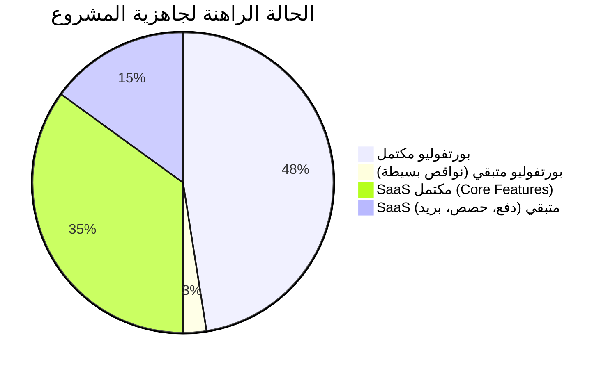
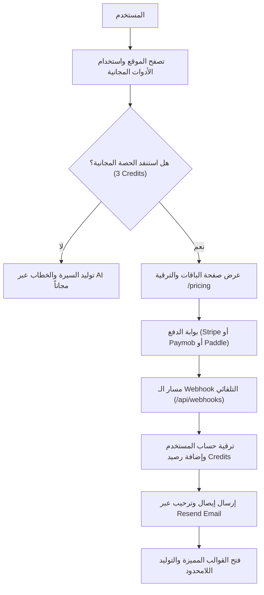

# 🗺️ خطة الوصول إلى الجاهزية الكاملة 100% (JobMatch AI)
## Dual-Track Execution Plan: Portfolio Excellence & Commercial SaaS

> **تاريخ الإنشاء:** أكتوبر 2026  
> **الحالة الحالية:** بورتفوليو (~95%) | منتج تجاري SaaS (~70%)  
> **الهدف الاستراتيجي:** استكمال الـ 5% المتبقية في البورتفوليو + استكمال الـ 30% المتبقية في الـ SaaS للوصول إلى جاهزية 100% من الجهتين.

---

## 📊 نظرة عامة: أين يقف المشروع الآن؟



---

# 🌟 المسار الأول: الإتقان الكامل للبورتفوليو والعمل الحر (Portfolio Track)
> **الهدف:** إبهار مدراء التوظيف (CTOs / Tech Leads) والعملاء الدوليين في أول 60 ثانية بمجرد فتح الرابط، دون أي عوائق تقنية.

### 📌 جدول مهام المسار الأول:

- [ ] **1. إضافة وضع الزائر السريع (One-Click Demo Guest Mode)**
  - **الملف المستهدف:** [`app/login/page.tsx`](file:///c:/Users/dell/Desktop/freelance/top-projects/AI-Resume/app/login/page.tsx) و [`app/api/auth/demo/route.ts`](file:///c:/Users/dell/Desktop/freelance/top-projects/AI-Resume/app/api/auth)
  - **الوصف:** إضافة زر `⚡ الدخول كزائر لتجربة النظام (Try Demo Instantly)` يقوم بتسجيل الدخول تلقائياً بحساب تجريبي محشو مسبقاً ببيانات:
    - سيرة ذاتية جاهزة ومكتملة لعرض الـ Builder.
    - تقرير فحص ATS محفوظ لعرض الـ Dashboard.
    - مسودة خطاب تقديم جاهزة للعرض الفوري.
  - **الأثر:** تجنيب العميل أو الـ Recruiter عناء كتابة بريد وباسورد جديدين.

- [ ] **2. إصلاح وتشغيل حزمة الاختبارات الفورية (`npm test`)**
  - **الملف المستهدف:** [`package.json`](file:///c:/Users/dell/Desktop/freelance/top-projects/AI-Resume/package.json)
  - **الوصف:** تثبيت حزمة `tsx` كـ devDependency لتعمل الاختبارات الثمانية دون أي تعليق أو طلب إدخال تفاعلي:
    ```bash
    npm install -D tsx
    ```
  - **الأثر:** إثبات تبني معايير هندسة البرمجيات واختبارات الجودة الصارمة (TDD) أمام أي مراجع تقني.

- [ ] **3. نشر التطبيق على رابط حي فائق الاستقرار (Live Deployment)**
  - **المنصات المقترحة:** Vercel (موصى بها) أو Render أو Hugging Face Spaces.
  - **إعداد قاعدة البيانات الحية:** ربط كلاستر مجاني من **MongoDB Atlas** في المتغير `MONGODB_URI` لمنع فقدان البيانات المحفوظة عند إعادة تشغيل السيرفرات السحابية.

- [ ] **4. إنتاج الوسائط المرئية وإثراء التوثيق (Showcase Assets & README)**
  - تسجيل فيديو قصير (60 إلى 90 ثانية) عبر Loom أو OBS يوضح:
    1. رفع ملف PDF واستخراج النصوص وفحص الـ ATS التلقائي.
    2. تعديل السيرة الذاتية وتصديرها بصيغتي Word و PDF.
    3. توليد خطاب تقديم بالذكاء الاصطناعي مع التبديل بين اللغتين (العربية والإنجليزية).
  - إضافة شارات الجودة (Badges) ومخطط معمارية النظام (Architecture Diagram) في ملف `README.md`.

- [ ] **5. صفحات الأخطاء المخصصة وتجربة الاستخدام (Error Boundaries & 404)**
  - إنشاء ملف [`app/not-found.tsx`](file:///c:/Users/dell/Desktop/freelance/top-projects/AI-Resume/app) و [`app/error.tsx`](file:///c:/Users/dell/Desktop/freelance/top-projects/AI-Resume/app) بتصميم مظلم متناسق مع الواجهة الأساسية لإظهار العناية بأدق التفاصيل.

---

# 💼 المسار الثاني: الإطلاق التجاري وتحقيق الأرباح (Commercial SaaS Track)
> **الهدف:** تحويل المنصة إلى شركة رقمية ناشئة (Micro-SaaS) مستدامة تبيع اشتراكات وحصص، مع حماية تكاليف استهلاك الـ AI APIs.

### 📌 المعمارية التجارية المقترحة:



---

### 📌 جدول مهام المسار الثاني:

### المرحلة 1: نظام الرصيد والحصص (Credits & Limits)
- [ ] **1.1 تحديث نموذج المستخدم في قاعدة البيانات**
  - **الملف المستهدف:** [`app/models/User.ts`](file:///c:/Users/dell/Desktop/freelance/top-projects/AI-Resume/app/models/User.ts)
  - إضافة حقول خطة الحساب والرصيد:
    ```typescript
    plan: { type: String, enum: ['free', 'pro', 'enterprise'], default: 'free' },
    aiCredits: { type: Number, default: 3 }, // 3 توليدات مجانية عند التسجيل
    billingCycle: { type: String, enum: ['monthly', 'annual', 'lifetime', 'none'], default: 'none' },
    stripeCustomerId: { type: String, default: '' },
    stripeSubscriptionId: { type: String, default: '' },
    ```
- [ ] **1.2 إضافة فاحص الرصيد (Credit Guard Middleware)**
  - **الملف المستهدف:** [`app/api/cover-letter/generate/route.ts`](file:///c:/Users/dell/Desktop/freelance/top-projects/AI-Resume/app/api/cover-letter/generate/route.ts) ومسارات التوليد الأخرى.
  - فحص رصيد المستخدم قبل استدعاء الـ API؛ في حال كان الرصيد صفراً والخطة `free`، يتم إرجاع استجابة `403 Payment Required` تتضمن رابط الترقية.
  - خصم 1 Credit تلقائياً عند نجاح كل عملية توليد.

---

### المرحلة 2: تصميم صفحة الأسعار والباقات (Pricing & Tiers)
- [ ] **2.1 بناء صفحة التسعير [`app/pricing/page.tsx`](file:///c:/Users/dell/Desktop/freelance/top-projects/AI-Resume/app)**
  - تصميم عصري بأسلوب البطاقات التفاعلية يشمل 3 مستويات:
    1. **الباقة المجانية (Starter):** 3 محاولات توليد AI + فحص ATS مجاني + قالب أساسي.
    2. **باقة المحترفين (Pro - $9/شهرياً أو 150 ج.م):** توليد غير محدود + كافة القوالب + تصدير Word و PDF بدون علامة مائية + دعم ذو أولوية.
    3. **باقة الشحن حسب الاستخدام (Pay-As-You-Go):** شحن 15 رصيد توليد مقابل $3 (مناسب لمن يقدم على وظائف لفترة محددة فقط).

---

### المرحلة 3: ربط بوابة الدفع ومعالجة الـ Webhooks
- [ ] **3.1 اختيار وربط مزود الدفع**
  - **للسوق العالمي:** **Paddle** أو **Stripe Checkout** (Paddle هو الأسهل لأنه MoR ويتكفل بالضرائب العالمية والفوترة بالكامل).
  - **للسوق المصري والعربي:** **Paymob** (يقبل بطاقات فيزا/ماستركارد، وميزة، ومحافظ فودافون كاش / إتصالات كاش) أو **Tap Payments** للخليج.
- [ ] **3.2 مسار استقبال إشعارات الدفع (Webhook Endpoint)**
  - إنشاء المسار: `app/api/webhooks/payment/route.ts`
  - التحقق من صحة التوقيع الأمني (Signature Verification) لمنع التزوير.
  - عند نجاح عملية الدفع:
    - تحديث `user.plan = 'pro'`.
    - تمديد تاريخ انتهاء الاشتراك أو إضافة الرصيد.

---

### المرحلة 4: نظام البريد الإلكتروني المالي والأمني (Transactional Emails)
- [ ] **4.1 ربط خدمة Resend أو Brevo**
  - تثبيت مكتبة `resend`:
    ```bash
    npm install resend
    ```
- [ ] **4.2 ميزات البريد الأساسية:**
  - **استعادة كلمة المرور:** إنشاء صفحة `/forgot-password` وإرسال رمز تحقق مؤمن صالح لمدة 15 دقيقة.
  - **رسالة الترحيب:** دليل سريع لكيفية الاستفادة من المنصة وزيادة فرص القبول بالوظائف.
  - **إيصال الاشتراك:** إرسال ملخص العملية فور تأكيد الدفع.

---

### المرحلة 5: المراقبة والتحليلات (Monitoring & Analytics)
- [ ] **5.1 تتبع أخطاء الإنتاج (Sentry Error Tracking):** التقاط أي خطأ برمجيات لحظياً على خوادم الإنتاج وحله قبل أن يؤثر على المستخدمين.
- [ ] **5.2 تحليلات سلوك المستخدم (PostHog أو Google Analytics 4):**
  - تتبع معدلات التحويل من زائر إلى مستخدم مسجل.
  - تتبع نسبة الوصول لصفحة الدفع وإتمام الاشتراكات (Funnel Conversion Rate).

---

# 📅 الخطة الزمنية المقترحة للتنفيذ (7 أيام)

| اليوم | التركيز والهدف | المخرجات الرئيسية |
| :---: | :--- | :--- |
| **اليوم 1** | **إنهاء مسار البورتفوليو 100%** | زر الدخول كزائر التجريبي + تثبيت `tsx` لاجتياز الفحوصات + نشر الرابط الحي على Vercel مع MongoDB Atlas. |
| **اليوم 2** | **الوسائط والتوثيق** | تسجيل الفيديو التجريبي (90 ثانية) + تحديث ملف الـ README بمخططات المعمارية والـ Badges. |
| **اليوم 3** | **نموذج الحصص والرصيد (Credits)** | إضافة حقول الـ `credits` و `plan` في الـ User Model + حماية مسارات الـ API بـ Guard. |
| **اليوم 4** | **واجهة صفحة الأسعار والباقات** | بناء وتصميم صفحة `/pricing` متوافقة تماماً مع الثيم المظلم ودعم اللغتين (عربي/إنجليزي). |
| **اليوم 5** | **بوابة الدفع والـ Webhooks** | ربط بوابة الدفع (Stripe/Paddle أو Paymob) ومسار معالجة الـ Webhook لتحديث البيانات تلقائياً. |
| **اليوم 6** | **خدمة البريد واستعادة الباسورد** | دمج مكتبة `resend`، وتفعيل مسار استعادة كلمة المرور المنسية، وإرسال تأكيدات الدفع. |
| **اليوم 7** | **الفحص الشامل والإطلاق التجريبي** | اختبار تجربة الشراء من البداية للنهاية (End-to-End Test) وإطلاق النسخة التجريبية الأولى (Beta Launch). |

---

# 💡 نصيحة للبدء الآن:
أفضل إستراتيجية هي **تنفيذ مهام اليوم الأول فوراً** (مسار البورتفوليو):
1. تثبيت `tsx` واختبار `npm test`.
2. إضافة زر **Demo Login** في صفحة تسجيل الدخول.
بذلك يصبح لديك مشروع خارق وجاهز 100% لعرضه على أي عميل أو شركة فوراً أثناء قيامنا ببناء بوابة الدفع والـ SaaS على مهل!
