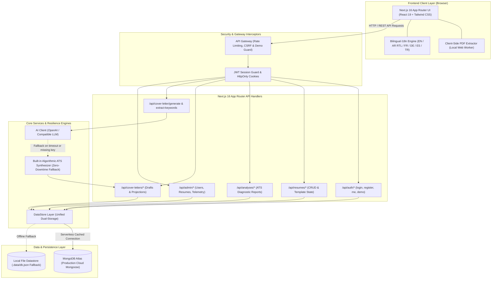

# JobMatch AI

> **Production-grade ATS Resume Builder, Diagnostic Scanner & AI Cover Letter Suite with zero-downtime client-side privacy.**

[](https://nextjs.org/)
[](https://react.dev/)
[](https://www.typescriptlang.org/)
[](https://tailwindcss.com/)
[](https://www.mongodb.com/atlas)
[](https://github.com/)
[](LICENSE)

---

## 🌐 Live Demo & Instant Access

- **Live Application:** [https://YOUR-APP.vercel.app](https://YOUR-APP.vercel.app) *(Replace with your Vercel deployment URL)*
- **⚡ Try Demo Instantly (`⚡ جرّب النظام فوراً`):**
  Navigate to `/login` and click the prominent amber **"⚡ Try Demo Instantly"** button. You will be authenticated immediately with zero registration required. The demo session is pre-seeded with:
  1. A complete **Junior Full-Stack Developer** resume that renders in the builder.
  2. A realistic **ATS Diagnostic Report** with an overall score of `88` ("Strong Match"), keyword analysis, and formatting suggestions.
  3. A tailored **AI Cover Letter Draft** formatted for cloud engineering applications.

---

## ✨ Key Features

### 📄 ATS Resume Builder
- **Battle-Tested Layouts:** Single and two-column standard formats engineered specifically to pass Taleo, Workday, Greenhouse, and standard HR parsers.
- **Dynamic Theme Controls:** Real-time font sizing, accent color palette selectors, and section reordering.
- **Academic & Executive CV (13 Sections PRO):** Extended multi-page layout supporting publications, honors, research grants, certifications, and leadership history.

### 🔍 Algorithmic ATS Diagnostic Scanner
- **100% Client-Side Privacy:** Local PDF parsing executes entirely inside your browser via client-side Web Workers (`pdfExtractor.ts`). No resume text is transmitted to external servers until you explicitly click analyze.
- **400+ Cataloged Industry Skills:** Algorithmic comparison evaluates contact details, reverse-chronological layout, metric density, and missing high-priority keywords.
- **Deterministic Scoring:** Provides actionable sub-scores (Keywords, Formatting, Structure, Content Quality) and keyword gap recommendations.

### ✍️ AI Cover Letter Generator
- **Bilingual Synthesis (Arabic & English):** Authentic, high-impact cover letter generation with automated RTL/LTR directionality.
- **4 Professional Tone Presets:**
  - `Formal`: Enterprise, banking, corporate, and governmental applications.
  - `Technical`: Developers, engineering leads, data scientists, and analysts.
  - `Leadership`: Directors, product managers, and executive leaders.
  - `Enthusiastic`: High-growth startups and innovative teams.
- **Keyword Extraction:** Automatic skill extraction from raw job description text or direct URL fetching with SSRF protection.
- **Zero-Downtime Fallback Engine:** If external AI keys are omitted, rate-limited, or offline, the platform seamlessly activates its built-in algorithmic ATS synthesizer without failing or interrupting the user experience.

### ⚡ Guest Demo System & Security
- **Idempotent Seeding:** Pre-populates clean demonstration data without creating duplicate documents on repeated clicks.
- **Hardened Demo Guards:** Demo accounts are locked in exploration mode; credentials cannot be modified, accounts cannot be deleted, and paid credits cannot be drained.
- **Enterprise-Grade Security:** Sliding-window in-memory rate limiting, strict IDOR ownership checks, CSRF origin verification, and HTML/XSS sanitization.

### 🌍 Multilingual Interface (i18n)
- Built-in support for **6 languages**: English (`en`), Arabic (`ar`), French (`fr`), German (`de`), Spanish (`es`), and Turkish (`tr`).
- Dynamic directional flipping (`dir="rtl"` vs `dir="ltr"`).

---

## 🏛️ System Architecture



---

## 🛠️ Tech Stack

| Category | Technology | Purpose |
|---|---|---|
| **Framework** | [Next.js 16](https://nextjs.org/) (App Router) | Full-stack serverless web application framework |
| **Frontend UI** | [React 19](https://react.dev/) | Component architecture & modern client-side state |
| **Styling** | [Tailwind CSS v4](https://tailwindcss.com/) & Vanilla CSS | Modern dark theme, glassmorphic styling, and `@media print` rules |
| **Language** | [TypeScript 5](https://www.typescriptlang.org/) | End-to-end static type safety and contract enforcement |
| **Database** | [MongoDB Atlas](https://www.mongodb.com/atlas) + Mongoose | Cloud document database with serverless connection pooling |
| **Fallback DB** | Local JSON Store (`.data/db.json`) | Zero-configuration offline local development database |
| **Auth** | JWT (`jose`) + HttpOnly Cookies | Stateless session management with 7-day token rotation |
| **AI Engine** | OpenAI API + Built-in ATS Engine | Hybrid generative synthesis with zero-dependency fallback |
| **Document Export** | `docx` + Native Vector Print | Word (.docx) generation and ATS-readable vector PDFs |
| **PDF Extraction** | Client-Side Web Workers (`pdfjs-dist`) | 100% private in-browser text parsing without server uploads |

---

## 📂 Project Structure

```text
JobMatch-AI/
├── app/
│   ├── api/                           # Next.js Serverless Route Handlers
│   │   ├── admin/                     # Administrative analytics & moderation
│   │   ├── analyses/                  # ATS diagnostic reports CRUD
│   │   ├── auth/                      # Authentication (login, register, me, demo, logout)
│   │   ├── cover-letter/              # AI synthesis & keyword extraction
│   │   ├── cover-letters/             # Saved cover letter drafts CRUD & pagination
│   │   └── resumes/                   # Saved resumes CRUD & template state
│   ├── builder/                       # Interactive ATS Resume Builder
│   ├── cv-builder/                    # Academic & Executive CV Builder (13 Sections)
│   ├── cover-letter/                  # AI Cover Letter Generator UI & tone selectors
│   ├── dashboard/                     # User dashboard with metrics & saved assets
│   ├── review/                        # ATS Diagnostic scanner & report viewer
│   ├── login/                         # Sign-in page with "Try Demo Instantly" button
│   ├── register/                      # User registration page
│   ├── components/                    # Reusable UI components (Navbar, Logo, LanguageSelector)
│   ├── context/                       # React Context providers (AuthContext, LanguageContext)
│   ├── lib/                           # Core utilities (auth, datastore, db, env, puter, rateLimit)
│   ├── models/                        # Mongoose schemas (User, Resume, Analysis, CoverLetter)
│   ├── error.tsx                      # Client error boundary with safe recovery controls
│   ├── global-error.tsx               # Root layout error boundary
│   ├── not-found.tsx                  # Branded 404 page with bilingual navigation
│   └── layout.tsx                     # Root HTML layout, Geist fonts, and client providers
├── docs/                              # Technical specifications & screenshot assets
│   ├── cover-letter-feature.md        # Comprehensive technical spec for Cover Letter engine
│   └── screenshots/                   # Application screenshots & walk-through images
├── lib/
│   └── env.ts                         # Root alias for runtime environment validation
├── scripts/                           # Automated integration & verification test suites
│   ├── run-all-cover-letter-tests.mjs # Master test runner managing server lifecycle
│   ├── test-demo-auth.mjs             # Demo endpoint, cookie & idempotency verification
│   ├── test-error-and-404.mjs         # 404 & error boundary contract verification
│   └── test-serverless-prep.mjs       # Serverless environment & Mongoose audit
├── .env.example                       # Documented environment variable template
├── DEPLOYMENT.md                      # Vercel & MongoDB Atlas deployment manual
├── vercel.json                        # Vercel function timeouts & build configuration
└── package.json                       # Project dependencies & scripts
```

---

## 🚀 Getting Started

### 1. Prerequisites
- **Node.js:** v18.18.0 or newer (Node.js 20+ recommended)
- **Package Manager:** `npm` (comes with Node.js)
- **MongoDB (Optional for Local Dev):** Local MongoDB instance or free [MongoDB Atlas](https://www.mongodb.com/atlas) cluster. (If omitted locally, the app seamlessly runs on `.data/db.json`).

### 2. Installation
```bash
# Clone the repository
git clone https://github.com/your-username/jobmatch-ai.git
cd jobmatch-ai

# Install dependencies
npm install
```

### 3. Environment Setup
Copy the template configuration file:
```bash
cp .env.example .env.local
```
*(Review `.env.local`. For local development, the default values allow you to run immediately without external credentials).*

### 4. Run Development Server
```bash
npm run dev
```
Open [http://localhost:3000](http://localhost:3000) in your browser.

### 5. Production Build
```bash
npm run build
```

---

## 🧪 Automated Testing

JobMatch AI includes automated test suites covering business logic, security permissions, IDOR protection, API contracts, and edge cases:

```bash
# Run all test suites non-interactively
npm test

# Verify Demo Guest Login flow
node scripts/test-demo-auth.mjs

# Verify 404 & Error Boundaries
node scripts/test-error-and-404.mjs

# Verify Serverless & Environment Configuration
npx tsx scripts/test-serverless-prep.mjs
```

### Test Coverage Highlights:
- **Suite 1:** Arabic Text Normalization & Keyword Frequency Algorithms
- **Suite 2:** REST API CRUD Operations & Summary Projections (`?summary=true`)
- **Suite 3:** Security, IDOR Boundaries, CSRF Host Origin & XSS Sanitization
- **Suite 4:** Server AI Resilience & Instant Fallback Engine
- **Suite 5:** Binary Detection, Oversized Payloads & SSRF URL Blocklist
- **Suite 6:** 6-Dimension Edge Cases & Unicode Stress Tests
- **Suite 7:** UI Stepper Progression, Concurrency & Double-Click Guards
- **Suite 8:** Performance Benchmarks & Sliding-Window Rate Limiting

---

## 📡 REST API Reference

| Endpoint | Method | Auth | Description |
|---|:---:|:---:|---|
| `/api/auth/demo` | `POST` | Public | Instant 1-click demo login. Seeds sample data and returns session JWT cookie. |
| `/api/auth/login` | `POST` | Public | Authenticates user with email and password. |
| `/api/auth/register` | `POST` | Public | Creates a new user account with hashed password. |
| `/api/auth/me` | `GET` | User | Returns the authenticated user profile and `isDemo` status. |
| `/api/auth/logout` | `POST` | User | Clears authentication cookies and invalidates the session. |
| `/api/resumes` | `GET` | User | Returns all resumes belonging to the authenticated user. |
| `/api/resumes` | `POST` | User | Creates a new resume draft. |
| `/api/resumes/[id]` | `GET`, `PUT`, `DELETE` | User | Retrieves, updates, or deletes a specific resume (IDOR protected). |
| `/api/analyses` | `GET`, `POST` | User | Lists saved ATS scan reports or persists a new diagnostic scan. |
| `/api/analyses/[id]` | `DELETE` | User | Deletes a saved ATS audit report. |
| `/api/cover-letter/generate` | `POST` | User | Synthesizes a tailored cover letter (OpenAI with local ATS fallback). |
| `/api/cover-letter/extract-keywords` | `POST` | User | Extracts high-frequency skills from text or job posting URLs. |
| `/api/cover-letters` | `GET` | User | Paginated list of cover letter drafts with `?summary=true` projection. |
| `/api/cover-letters` | `POST` | User | Creates a new cover letter draft. |
| `/api/cover-letters/[id]` | `GET`, `PATCH`, `DELETE` | User | Inspects, modifies, or deletes a specific cover letter draft. |
| `/api/admin/stats` | `GET` | Admin | Telemetry, user counts, and score distribution metrics. |
| `/api/admin/users` | `GET`, `PATCH`, `DELETE` | Admin | User account administration. |

---

## 📸 Screenshots & Visual Walkthrough

> For design tokens, color palette, and typography standards, see [docs/BRAND_IDENTITY.md](docs/BRAND_IDENTITY.md).  
> For complete capture instructions, viewports, and asset manifests, see [docs/screenshots/README.md](docs/screenshots/README.md).

| Landing Hero & ATS Diagnostics | Interactive Resume Builder |
|:---:|:---:|
|  |  |
| *Algorithmic ATS Scoring & Skill Gap Detection* | *Real-time Typography & Multi-column Layouts* |

| User Dashboard & Document Hub | ATS Diagnostic Result Breakdown |
|:---:|:---:|
|  |  |
| *Metric KPIs, Resume List, and Next-Best-Action* | *Sub-scores, Formatting & Keyword Gap Analysis* |

| AI Cover Letter Generator | Arabic (RTL) Native Experience |
|:---:|:---:|
|  |  |
| *Tone Presets, Streaming State & Rich Editor* | *IBM Plex Sans Arabic Typography & Mirrored UI* |

| Responsive Mobile Experience (360px) |
|:---:|
|  |
| *Touch-Friendly Navigation & Sticky Action Controls* |

> 📹 **Video Demo:** [Watch the Product Walkthrough on YouTube](https://youtube.com) *(Demo walkthrough link)*

---

## 🗺️ Product Roadmap (Commercial SaaS)

- [x] **Track 1: Foundation & Production Readiness**
  - [x] Non-interactive automated test suite (`npm test`)
  - [x] 1-Click "Try Demo Instantly" guest session
  - [x] Custom dark-theme 404, error boundary, and global root boundary
  - [x] Serverless-safe MongoDB Atlas architecture & Vercel deployment manual
  - [x] Complete developer showcase & documentation
- [ ] **Track 2: SaaS Commercialization & Monetization**
  - [ ] Usage Quotas & Subscription Credit System (Free vs Pro tiers)
  - [ ] Stripe / LemonSqueezy payment integration with webhook sync
  - [ ] LinkedIn Profile Importer via PDF parsing
  - [ ] Recruiter Candidate Sharing with password-protected public links
  - [ ] Custom Domain publishing for portfolio resumes

---

## 📄 License

This project is licensed under the **MIT License**. See the [LICENSE](LICENSE) file for details.

---

<div align="center">
  <sub>Built with care for job seekers worldwide by the <strong>JobMatch AI</strong> team.</sub>
</div>
