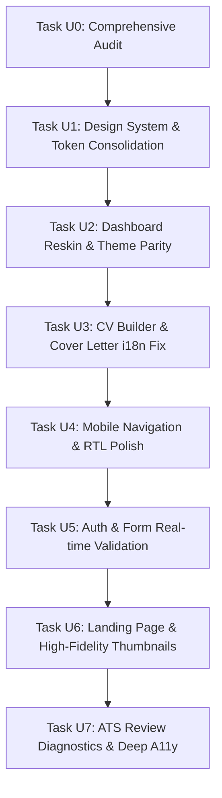

# JobMatch AI — Comprehensive UI/UX & Design System Audit

**Document Version:** 1.0.0  
**Audit Date:** October 2026  
**Audited Stack:** Next.js 15 (App Router), React 19, TypeScript, Tailwind CSS v4, Paper & Ink Design System, IBM Plex Sans & Arabic, Newsreader.  
**Auditor:** Antigravity AI  

---

## Executive Summary

JobMatch AI has a distinguished and thoughtful visual foundation: an editorial **"Paper & Ink"** aesthetic that eschews generic SaaS purple gradients in favor of high-contrast, typographically rich document design (WCAG AA compliant). However, significant discrepancies exist between the core design system specification and several production pages.

Most notably:
- The **Dashboard (`/dashboard`)** completely breaks out of the design system with hardcoded dark slate/cyan classes, breaking light mode entirely.
- The **Cover Letter Generator (`/cover-letter`)** conflates target document language with application interface language.
- The **CV Builder (`/cv-builder`)** completely lacks internationalization and RTL support.
- Several pages bypass canonical UI primitives (`Button`, `Input`, `Card`) in favor of inconsistent inline styles.
- Mobile drawer and sticky bottom rails require safe-area insets and directionally mirrored navigation glyphs.

This document details all findings across five comprehensive sections and establishes a prioritized roadmap (P0/P1/P2) for systematic execution.

---

## 1. Current Design System Findings

### 1.1 Color Tokens & Theme System

The design system is built around the **Paper & Ink** metaphor defined in `app/globals.css` and extended via `tailwind.config.ts`.

#### Semantic Tokens Overview:
| Token Name | Light Theme Value | Dark Theme Value | Purpose & Contrast |
| :--- | :--- | :--- | :--- |
| `--paper` | `#FAF8F4` | `#0F1311` | Primary background canvas |
| `--surface` | `#FFFFFF` | `#171C19` | Elevated cards, panels, inputs |
| `--surface-2` | `#F3F0EA` | `#1E2420` | Secondary fill, table headers, hovered rows |
| `--ink` | `#14181F` | `#EDEBE5` | Primary body and heading text (16.78:1 contrast) |
| `--ink-2` | `#4A5160` | `#B4B9B3` | Secondary text, descriptions (7.51:1 contrast) |
| `--ink-3` | `#6B7280` | `#8E948E` | Tertiary text, metadata, captions (4.56:1 contrast) |
| `--line` | `#E4DFD5` | `#2A322D` | Subtle borders, dividers |
| `--line-strong` | `#8E887C` | `#69786E` | Input borders, emphasized separators (3.52:1 contrast) |
| `--accent` | `#0F5C4D` | `#3FB596` | Deep pine / jade primary brand CTA (7.45:1 contrast) |
| `--accent-hover` | `#0B4A3E` | `#5CC8AC` | Hover state for accent buttons |
| `--accent-soft` | `#E3EFEA` | `#16302A` | Active tab highlights, badge backgrounds |
| `--on-accent` | `#FFFFFF` | `#08110E` | Foreground text on accent backgrounds |
| `--highlight` | `#C8892B` | `#E0A84A` | Single-element emphasis / warnings |
| `--danger` | `#B3261E` | `#F2877F` | Form errors, destructive actions |
| `--danger-soft`| `#FBEAE8` | `#3A1F1D` | Error banner backgrounds |
| `--success` | `#156E3F` | `#5CC48B` | Positive verification, pass states |
| `--warning` | `#9A5B00` | `#E0A84A` | Cautions, moderate ATS scores |

#### Core Color Inconsistencies:
1. **Dashboard Rogue Theme:** `app/dashboard/page.tsx` hardcodes Tailwind slate colors (`bg-slate-950`, `text-slate-100`, `text-cyan-400`, `text-emerald-300`, `border-slate-800`, `bg-blue-500/10`). Switching the app to light mode leaves the dashboard completely pitch black.
2. **Hardcoded Hex Literals:** `app/builder/page.tsx` and `app/cv-builder/page.tsx` hardcode `#0F5C4D` for theme colors instead of referencing the CSS variable `var(--accent)`.
3. **Document Preview Paper Lock:** `app/globals.css` properly forces `#resume-preview` and `#cover-letter-sheet` to remain `#FFFFFF` paper in both light and dark modes (vital for real-world printing accuracy), but some builder borders bleed dark mode lines into the sheet.

---

### 1.2 Fonts & Typography

The application utilizes three Google Fonts loaded through `next/font/google` in `app/layout.tsx`:
- **Serif (Headings):** `Newsreader` (weights: 400, 500, 600; normal and italic) mapped to `--font-serif`.
- **Sans-Serif (UI & Latin Body):** `IBM Plex Sans` (weights: 400, 500, 600, 700) mapped to `--font-sans`.
- **Arabic (Arabic UI & Typography):** `IBM Plex Sans Arabic` (weights: 400, 500, 600, 700) mapped to `--font-arabic`.

#### Typography Rules:
- Headings (`h1`, `h2`, `.font-h1`, `.font-h2`) use fluid typography with `clamp()`:
  - `h1`: `clamp(2rem, 1.2rem + 3.5vw, 4rem)`, line-height: `1.15`, letter-spacing: `-0.02em`.
  - `h2`: `clamp(1.5rem, 1.1rem + 1.8vw, 2.5rem)`, line-height: `1.25`, letter-spacing: `-0.02em`.
- Arabic typography correctly overrides letter spacing (`letter-spacing: normal`) and increases line-height to `1.8` for enhanced glyph legibility.

#### Typography Inconsistencies:
- **Serif Arabic Fallback:** When Arabic is active, `[dir="rtl"] h1` correctly defaults to `var(--font-arabic)`, but in mixed English/Arabic preview templates, serif styling is sometimes lost.
- **Tabular Figures:** Numbers across ATS scores and pricing cards use `.tabular-nums`, but resume dates and phone numbers in several templates lack font-variant-numeric tabular styling.

---

### 1.3 Spacing, Radii & Shadows

#### Scale Hierarchy:
- **Container Max-Widths:**
  - Standard Content: `max-w-[1160px]` (`Navbar`, `Footer`, Landing sections, ATS Review, Pricing).
  - Dashboard: `max-w-7xl` (`1280px`).
  - Resume Builder: `max-w-[1720px]` (for 3-pane responsive desktop workstation).
  - Auth Cards & Modals: `max-w-[400px]` (Auth), `max-w-lg` (`512px` Modals).
- **Border Radii:**
  - System specification: `--radius-sm: 4px`, `--radius-md: 6px`, `--radius-lg: 10px`.
  - Inconsistency: Pages frequently introduce arbitrary Tailwind classes such as `rounded-2xl` (16px), `rounded-xl` (12px), `rounded-full`, and `rounded-sm` (2px).
- **Elevation & Shadows:**
  - System specification: `--shadow-subtle`, `--shadow-card`, `--shadow-elevated`.
  - Inconsistency: Dashboard uses colored glow shadows (`shadow-emerald-600/20`), which clash with the understated editorial aesthetic.

---

### 1.4 Component Inventory & Fragmentation

The project includes 16 standalone UI components in `app/components/ui/`:
1. `Accordion.tsx` — Native accessible details accordion.
2. `Badge.tsx` — Status tags (default, success, warning, danger, accent).
3. `Button.tsx` — Standard buttons with `primary`, `secondary`, `outline`, `ghost`, `destructive` variants and `isLoading` spinner.
4. `Card.tsx` & `CardHeader` — Surface containers with subtle borders and interactive hover lifts.
5. `Dialog.tsx` — Accessible modal with focus trap, Esc listener, and mobile bottom sheet behavior.
6. `Dropzone.tsx` — In-browser file dropzone with drag states and parse animations.
7. `EmptyState.tsx` — Standard zero-data layout.
8. `Input.tsx` — Accessible text input with label, helperText, error state, and start/end addons.
9. `SegmentedControl.tsx` — Pill toggle for billing cycles, modes, and filters.
10. `Select.tsx` — Dropdown select.
11. `Skeleton.tsx` — Loading pulse placeholders.
12. `Stepper.tsx` — Multi-step progress bars.
13. `Tabs.tsx` — Underline and pill tab strips.
14. `Textarea.tsx` — Multi-line text field with error states.
15. `Toast.tsx` — Floating notifications.
16. `index.ts` — Unified export barrel.

#### Component Inventory Disconnect:
Despite having high quality, accessible primitives in `app/components/ui/`, many key pages bypass them:
- `app/builder/page.tsx` top navbar implements 6 raw `<button>` elements with redundant inline classes instead of `<Button variant="secondary" size="sm">`.
- `app/dashboard/page.tsx` re-invents cards and buttons with custom slate classes instead of `<Card>` and `<Button>`.
- `app/login/page.tsx` and `app/register/page.tsx` use raw `<input>` elements rather than `<Input label="..." error="..." />`.

---

## 2. Page-by-Page UX Audit

### 2.1 Landing Page (`/`)
- **Hero CTA Competing Hierarchy:** The Hero displays two primary-weight actions side-by-side: "Build my resume" (solid accent) and "Check my current CV" (surface button). On mobile, both take full width, creating decision fatigue.
- **Abstract Template Thumbnails:** The "Editorial Formats" section (lines 384–401) shows abstract wireframe bars (`w-24 h-2.5 bg-ink`) rather than actual rendered visual previews of the real templates (Compact ATS, Two-Column, Executive). This fails to give users an immediate sense of the output quality.
- **Tone Selector State Loss:** The Cover Letter Tone demo lets users preview "Professional", "Technical", and "Concise" tones, but clicking through to the generator resets the choice to the default.
- **Dropzone File Flow:** Dropping a file in the landing hero dropzone stores text in `sessionStorage` and redirects to `/review`. However, if the text extraction produces warnings, the user is redirected without seeing the warning banner first.

---

### 2.2 Login & Register (`/login`, `/register`)
- **RTL Arrow Directional Bug:** The "Back to Homepage" link at the bottom of both pages uses a literal left arrow:
  ```tsx
  {isAr ? '← العودة للصفحة الرئيسية' : '← Back to Homepage'}
  ```
  In Arabic (RTL), `←` points forward/end-of-line, confusing the user. It should point `→` or use an icon with `rtl:rotate-180`.
- **Registration Validation Timing:** Password mismatch and length validation only run upon clicking "Create Account". Real-time inline feedback while typing is absent.
- **Password Visibility Accessibility:** The toggle password visibility button lacks an `aria-pressed` or dynamically updated `aria-label` ("Show password" / "Hide password").
- **Missing Social Authentication:** There is no single-sign-on (Google / LinkedIn / GitHub) option; only email/password or temporary demo session.

---

### 2.3 Dashboard (`/dashboard`)
- **Theme Lockout (Critical):** The page forces `bg-slate-950 text-slate-100` regardless of the user's theme selection. When a user clicks the theme toggle to select Light Mode, the navbar and footer respond, but the dashboard body remains black slate.
- **Incomplete Internationalization (Critical):** Almost all strings on the dashboard are hardcoded English:
  - "Cloud Dashboard", "Welcome back", "Quick Stats", "Saved Resumes", "Account Plan", "AI Credits", "My Resumes & CVs", "Saved ATS Scan Reviews", "Scan Another CV →".
- **Directional Glyph:** "Scan Another CV →" does not mirror its arrow in Arabic RTL.
- **Date Localization:** Dates are rendered with `toLocaleDateString('en-US')` even when Arabic is selected.
- **Zero-State Empty State:** When a user has no resumes, the empty state uses custom slate styles rather than `<EmptyState>`.

---

### 2.4 ATS Scan & Diagnostic Review (`/review`)
- **Raw Extracted Text Modal:** Clicking "View extracted text" opens a raw monospace modal without search or keyword highlights. Users cannot easily see where in their resume a matched keyword occurred.
- **Destructive Re-upload:** Uploading a new resume immediately overwrites the session storage without checking if the user had unsaved job description comparison notes.
- **Job Description Comparison Modal:** Comparing a job description is buried inside a dialog rather than being accessible as a side-by-side split screen.
- **Print Optimization:** The "Print / Vector PDF" button simply invokes `window.print()`. If the user is on mobile or tablet, the print preview contains unnecessary margins.

---

### 2.5 Resume Builder (`/builder`) & CV Builder (`/cv-builder`)
- **CV Builder Missing i18n Entirely (Critical):** `app/cv-builder/page.tsx` does NOT import or use `useLanguage()`. Every single string ("My Comprehensive Curriculum Vitae", "Saved just now", "Back to Dashboard", "Save to Cloud", "Download PDF", "Word", "Print", "Clear", "Sample") is hardcoded in English.
- **Mobile Mode Switching Friction:** On mobile, switching between "Editor", "Preview", and "Sections" causes full scroll position resets. If an applicant edits work experience item #3 and toggles to Preview, they lose their place in the editor upon returning.
- **Touch Reordering:** Drag-and-drop section reordering works well with a desktop mouse, but has touch conflict with mobile vertical scrolling.
- **Top Bar Component Duplication:** In `app/builder/page.tsx`, the top bar uses 6 inline buttons with custom padding and font sizes rather than using the standard `<Button>` component.

---

### 2.6 Cover Letter Generator (`/cover-letter`)
- **Document Language vs. Interface Language Bug (Critical):** In `app/cover-letter/page.tsx`:
  ```tsx
  const [language, setLanguage] = useState<CoverLetterLanguage>('ar');
  const isAr = language === 'ar';
  ```
  `isAr` is derived from the **target document output language**, not `useLanguage()`. If an English speaker needs to generate an Arabic cover letter, the entire website UI flips to Arabic! Conversely, if an Arab applicant wants an English cover letter for an overseas job, all UI labels turn English.
- **Missing Input Character Counts:** Job description textareas have no minimum/maximum length indicators or quality meters.
- **Generation Stepper Feedback:** While generating, the stepper displays static delay animations rather than progressive streaming token feedback.

---

### 2.7 Pricing (`/pricing`)
- **Deceptive CTA Interaction:** Clicking "Get Started" on paid tiers triggers a generic toast:
  > *"Payment gateway integration is being finalized. Your selection has been noted."*
  This surprises users who expected a checkout flow. It should be presented transparently as "Join Waitlist" or "Request Early Access" modal.
- **Currency Switcher:** Defaults to USD without auto-detecting regional currency (EGP in Egypt, SAR in Saudi Arabia, AED in UAE).
- **Annual Discount Pill:** The "Save 22%" badge in the billing toggle has unequal horizontal margins in RTL mode.

---

### 2.8 404 & Global Error (`/not-found`, `/error`)
- **Strengths:** Both pages adhere faithfully to the Paper & Ink tokens, provide theme and language selectors, and include localized strings.
- **UX Gaps:**
  - Neither page contains an inline search input to help stranded users quickly find their desired resume, CV, or tool.
  - The Error page displays a cryptic `Reference ID` without a "Copy diagnostic info" button for support ticketing.

---

## 3. Mobile & RTL Issues Detected in Code

### 3.1 RTL Mirroring & Directional Indicators
1. **Hardcoded Arrow Characters:**
   - `app/login/page.tsx:223`: `← Back to Homepage`
   - `app/register/page.tsx`: `← Back to Homepage`
   - `app/dashboard/page.tsx:373`: `Scan Another CV →`
   - `app/page.tsx:418`: `Use this layout →`
   *Fix:* Use `rtl:rotate-180` on Lucide arrow icons or dynamic string switching.
2. **Horizontal Overflow in Sample Switcher:** In `app/review/page.tsx:264`, the ribbon `Load Sample:` can overflow on small mobile screens (<360px) without a fading gradient mask indicating scrollability.
3. **Drawer Slide Direction:** The mobile menu drawer in `app/components/Navbar.tsx` always slides in from the right (`justify-end`), even in RTL where menus traditionally slide from the start/right side or require explicit logical alignment.

### 3.2 Mobile Viewports (<375px) & Safe Area Insets
1. **Missing Safe Area Bottom Padding:**
   - In `app/builder/page.tsx` and `app/cv-builder/page.tsx`, the mobile bottom tab bar (`sticky bottom-0`) does not include `pb-[env(safe-area-inset-bottom)]`. On modern iPhones, the home swipe bar directly overlaps the "Preview" and "Edit" buttons.
2. **Dropzone Mobile Hit Targets:** `Dropzone.tsx` provides adequate padding on desktop, but on 360px mobile viewports, the icon and text stack tightly, causing accidental double taps.
3. **Table Comparison on Small Screens:** The Pricing comparison matrix (`app/pricing/page.tsx`) overflows horizontally on mobile viewports; it needs a sticky feature-name column or card-based mobile view.

---

## 4. Accessibility (a11y) Audit

### 4.1 Color Contrast Evaluation (WCAG AA Compliance)
- **Paper & Ink Core Palette:** Passes WCAG AA across all primary text (16.78:1), secondary text (7.51:1), and accent buttons (7.45:1).
- **Dashboard Failures:**
  - `text-slate-400` on `bg-slate-950` provides a contrast ratio of **4.21:1**, which fails the required **4.5:1** minimum for small body text (10px–12px metadata).
  - `text-cyan-400` on `bg-slate-900` achieves only **4.1:1** contrast on subheadings.
- **Document Paper Preview:** In dark mode, `#resume-preview` correctly forces `--paper: #FFFFFF` and `--ink: #14181F`, ensuring printed document previews maintain maximum contrast regardless of UI theme.

### 4.2 Focus Indicators & Keyboard Traps
- **Focus Rings:** `globals.css` sets `:focus-visible { outline: 2px solid var(--focus) !important; outline-offset: 2px !important; }`. This works reliably on native elements.
- **Violations:**
  - `app/components/LanguageSelector.tsx`: The dropdown menu items lack keyboard arrow navigation (`ArrowDown`, `ArrowUp`, `Home`, `End`) and do not trap focus when open. Pressing `Escape` does not close the dropdown.
  - Custom buttons in `app/builder/page.tsx` use `focus:outline-none` without an explicit replacement `focus-visible:ring-2`.
- **Skip Link:** `app/layout.tsx` includes a `<a href="#main-content">Skip to main content</a>` element, which is excellent. However, some subpages (`/cv-builder`, `/dashboard`) lacked matching `<main id="main-content">` target anchors.

### 4.3 Form Semantics & ARIA Attributes
- **Input Error Associations:** `app/components/ui/Input.tsx` properly implements `aria-invalid={!!error}` and `aria-describedby={error ? errorId : helperId}`.
- **Violations on Custom Forms:**
  - `app/login/page.tsx` and `app/register/page.tsx` use raw `<input>` elements without `aria-describedby` pointing to error alerts.
  - Resume rename input (`app/builder/page.tsx:379`) has no associated `<label>` or `aria-label`, relying solely on a hover `title` attribute.
  - File upload inputs are `hidden` with `display: none`. When triggered via button ref, screen reader focus remains stuck on the triggering button without announcement of the file chooser opening.

---

## 5. Prioritized Fix List & Recommended Roadmap

### Priority 0 (P0) — Critical Architectural & UX Blockers
*These issues directly break features, violate theming, or create severe user confusion.*

1. **Dashboard Theme Overhaul:**
   - Remove all hardcoded `slate-950`, `slate-900`, `cyan-400`, and `emerald-400` classes in `app/dashboard/page.tsx`.
   - Re-skin the entire dashboard using `--paper`, `--surface`, `--surface-2`, `--ink`, `--line`, and `--accent`.
   - Restore 100% Light Mode and Dark Mode parity.
2. **Decouple Document Language from Interface Language:**
   - In `app/cover-letter/page.tsx`, separate `documentLanguage` (the language of the generated letter) from `uiLanguage` (provided by `useLanguage()`).
   - Allow users to generate English letters in an Arabic interface and Arabic letters in an English interface.
3. **Internationalize CV Builder:**
   - Integrate `useLanguage()` into `app/cv-builder/page.tsx` and all child components.
   - Add Arabic and English translations for all CV builder actions, headers, and toolbars.
4. **Fix RTL Directional Glyphs:**
   - Correct all backwards navigation arrows (`←`, `→`) across Login, Register, Dashboard, and Landing.

---

### Priority 1 (P1) — SaaS Polish & Component Standardization
*These issues elevate the design from minimum-viable to a cohesive, premium SaaS feel.*

1. **Standardize Page Primitives:**
   - Refactor `app/builder/page.tsx` top navbar to use canonical `<Button>` components.
   - Refactor auth forms (`/login`, `/register`) to use `<Input>` with floating/clean labels and inline real-time validation.
2. **Mobile Safe Area & Sticky Tab Polish:**
   - Add `env(safe-area-inset-bottom)` to mobile builder bottom bars.
   - Preserve scroll offsets when switching between mobile Editor and Preview tabs.
3. **High-Fidelity Landing Page Thumbnails:**
   - Replace abstract wireframe placeholder bars in the Editorial Formats gallery with high-fidelity, scaled mini-document preview renders.
4. **Transparent Checkout / Waitlist Flow:**
   - Update Pricing buttons for unreleased payment gateways to trigger a polished "Join Pro Waitlist" dialog instead of an abrupt generic toast.
5. **Dashboard Internationalization & Date Formatting:**
   - Localize all dashboard statistics cards, headings, and empty states.
   - Use locale-aware date formatters (`Intl.DateTimeFormat`) matching the active user language.

---

### Priority 2 (P2) — Delight, Micro-interactions & Deep Accessibility
*Refinements that make the experience feel effortless and accessible to all users.*

1. **Keyboard Accessibility on Menus:**
   - Add full ARIA menu keyboard navigation (Arrow keys, Esc, Home/End) to `LanguageSelector` and `ThemeToggle`.
2. **Enhanced ATS Diagnostic Viewer:**
   - Add search and side-by-side keyword highlighting in the "View extracted text" modal on `/review`.
3. **Dashboard Document Management:**
   - Add search, filtering, and template badge filters to saved resumes and CVs.
4. **Smart 404/Error Recovery:**
   - Add an instant search bar to `/not-found` and a one-click "Copy diagnostic report" button to `/error`.

---

## Recommended Order of Work



1. **Phase 1: Foundations & Theme Parity** (Fix Dashboard dark lock, normalize token usage across all pages).
2. **Phase 2: Internationalization & Directionality** (CV Builder translations, Cover letter language decoupling, RTL glyph fixes).
3. **Phase 3: Component Standardization & Mobile UX** (Replace ad-hoc inputs/buttons with primitives, safe area insets, mobile tab persistence).
4. **Phase 4: Landing & Visual Fidelity** (High-fidelity template thumbnails, pricing waitlist modal, micro-animations).
5. **Phase 5: Deep Accessibility & Final Polish** (Keyboard traps, ARIA focus management, search recovery on error/404).
