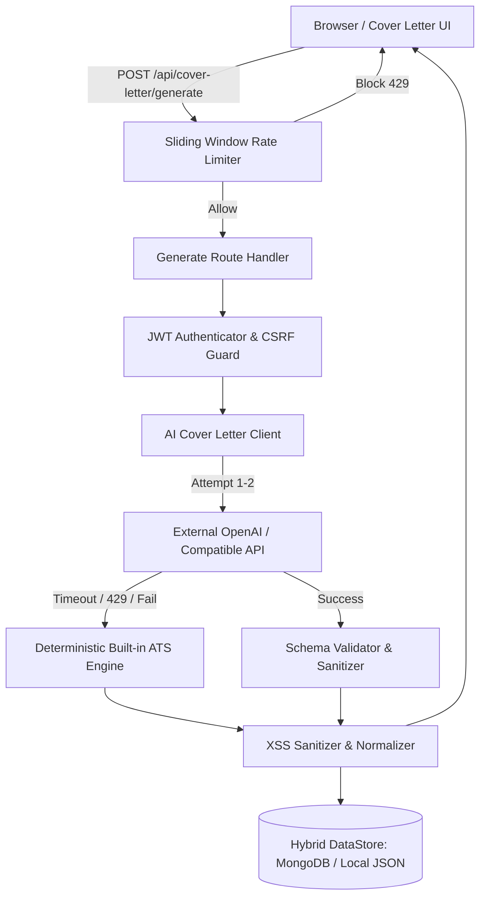

# دليل التوثيق الفني لميزة «مولد خطابات التقديم الذكي»
## AI Cover Letter Generator — Technical & Operational Documentation

---

### 1. نظرة عامة (Overview)
ميزة **«مولد خطابات التقديم الذكي» (AI Cover Letter Generator)** هي إضافة مدمجة داخل منصة **JobMatch AI**، تهدف إلى تمكين الباحثين عن عمل والمهنيين من توليد خطابات تغطية وتقديم مخصصة بنسبة 100% لأي إعلان وظيفي بنقرة زر واحدة، مستندة إلى بيانات السيرة الذاتية واشتراطات جهة التوظيف.

تتميز الإضافة بهندسة فائقة الصمود تجمع بين قوة نماذج الذكاء الاصطناعي التوليدية المتقدمة (LLMs) ومحرك خوارزمي محلي مدمج فائق الدقة (Built-in ATS Synthesizer) يضمن استمرارية الخدمة بنسبة 100% دون توقف حتى في حال غياب مفاتيح API الخارجية أو انقطاع الاتصال.

---

### 2. المزايا الرئيسية (Key Features)

1. **استخراج الكلمات المفتاحية التلقائي (Automatic Keyword Extraction):**
   - استخراج مهارات ومتطلبات الوظيفة من النص المباشر أو جلب محتوى رابط الإعلان.
   - تحليل تكرار الكلمات وخوارزمية TF-IDF مدمجة لعزل الكلمات الأكثر تأثيراً في أنظمة الـ ATS.
   - إمكانية إضافة وإزالة الكلمات المفتاحية يدوياً عبر واجهة تفاعلية.

2. **اختيار نبرة الخطاب (Tone Selection):**
   - **رسمي (Formal):** موجه للمؤسسات الكبرى، البنوك، والجهات الحكومية والقطاعات التقليدية.
   - **تقني (Technical):** مخصص لوظائف الهندسة البرمجية، تحليل البيانات، البنية التحتية والذكاء الاصطناعي.
   - **قيادي (Leadership):** موجه للمناصب الإدارية، مديري المنتجات، ورؤساء الفرق.
   - **حماسي (Enthusiastic):** ملائم للشركات الناشئة، بيئات العمل السريعة والابتكارية.

3. **دعم ثنائي اللغة كامل (Bilingual Arabic & English Support):**
   - توليد خطابات احترافية باللغة العربية الفصحى أو الإنجليزية.
   - تبديل تلقائي وكامل لاتجاه الصفحة والعناصر (`dir="rtl"` و `dir="ltr"`) وتوافق الطباعة.

4. **تطابق القوالب والمعاينة المباشرة (Template Parity):**
   - 4 قوالب مطابقة وموازية لقوالب السير الذاتية:
     - `modern`: تصميم أنيق بشريط علوي مميز وتنسيق متوازن.
     - `compact`: تركيز مكثف ومثالي لخطابات الصفحة الواحدة.
     - `classic`: الطابع الأكاديمي والتقليدي الموثوق.
     - `ats-friendly`: بساطة قصوى ومحاذاة تضمن قراءة آلية خالية من أي تشويش لأنظمة الفرز.

5. **تصدير PDF والنسخ بنقرة واحدة (Direct PDF Export & Pristine Copy):**
   - تصدير مباشر عبر محرك الطباعة عالي الدقة `@media print` بقياس A4 قياسي دون الحاجة لمكتبات ثقيلة تؤثر على حجم الحزم.
   - زر نسخ فوري مع تنظيف شامل لأي وسوم غير مرئية أو أسطر زائدة.

6. **حفظ ومزامنة المسودات (Drafts Auto-save & Database Persistence):**
   - حفظ تلقائي محلي بدون تجميد واجهة المستخدم (Debounced 350ms).
   - مزامنة سحابية في قاعدة البيانات مع دعم التصنيف (`saved`, `applied`, `archived`).
   - إسقاط انتقائي للبيانات (`?summary=true`) يقلل استهلاك النطاق الترددي للشبكة بنسبة تتجاوز 95%.

---

### 3. المعمارية التقنية ومسارات النظام (Architecture & Data Flow)



---

### 4. المتغيرات البيئية (Environment Variables)

| المتغير | النوع | القيمة الافتراضية | الوصف |
| :--- | :---: | :--- | :--- |
| `MONGODB_URI` | اختياري | `mongodb://127.0.0.1:27017/jobmatch` | عنوان الاتصال بقاعدة بيانات MongoDB. في حال تعذره، يعتمد النظام تلقائياً على `.data/db.json`. |
| `JWT_SECRET` | إلزامي | - | مفتاح التوقيع والتحقق لجلسات المستخدمين ورموز المصادقة. |
| `ADMIN_KEY` | إلزامي | - | المفتاح السري للعمليات الإدارية الخاصة ومسارات الفحص. |
| `ADMIN_EMAILS` | اختياري | `admin@jobmatch.ai` | قائمة البريد الإلكتروني للمسؤولين مفصولة بفواصل. |
| `NEXT_PUBLIC_APP_URL` | إلزامي | `http://localhost:3000` | رابط المنصة الأساسي للتحقق من أصول طلبات CSRF و CORS. |
| `NEXT_PUBLIC_API_URL` | اختياري | `http://localhost:3000/api` | رابط واجهات الـ API للواجهات الأمامية. |
| `OPENAI_API_KEY` | اختياري | `""` | مفتاح مزود الذكاء الاصطناعي (OpenAI أو أي مزود متوافق). |
| `OPENAI_MODEL` | اختياري | `gpt-4o-mini` | اسم النموذج اللغوي المستهدف. |
| `OPENAI_BASE_URL` | اختياري | `https://api.openai.com/v1` | نقطة الاتصال الأساسية للمزود. |
| `AI_REQUEST_TIMEOUT_MS`| اختياري | `15000` | المهلة الزمنية القصوى بالمللي ثانية قبل التحويل إلى المحرك المحلي. |
| `AI_MAX_RETRIES` | اختياري | `2` | عدد محاولات إعادة الطلب عند أخطاء الشبكة العابرة. |
| `AI_PROVIDER_ENABLED` | اختياري | `true` | خيار تفعيل أو تعطيل الاتصال الخارجي وإلزام المحرك المحلي. |

---

### 5. ترحيل البيانات ومخطط قاعدة البيانات (Database Schema & Migration)

#### أ. مخطط البيانات (Mongoose / DataStore Model):
يحتوي جدول `coverletters` على الحقول التالية:
- `userId`: معرف المستخدم المالك.
- `title`: عنوان مسودة الخطاب.
- `companyName`: اسم الشركة المستهدفة.
- `jobTitle`: المسمى الوظيفي.
- `jobDescription`: النص الكامل للوصف الوظيفي (يُسقط في استعلامات القوائم لتقليل الحجم).
- `content`: كائن منظم يحتوي على:
  - `subject`: سطر الموضوع.
  - `salutation`: التحية الافتتاحية.
  - `introduction`: الفقرة التمهيدية وسبب التقديم.
  - `bodyParagraphs`: مصفوفة فقرات الإنجازات والمهارات المطابقة.
  - `conclusion`: الفقرة الختامية والدعوة للتواصل.
  - `signOff`: التحية الختامية واسم المرسل.
  - `fullText`: النص المنسق الكامل للخطاب.
- `tone`: نبرة الخطاب (`formal`, `technical`, `leadership`, `enthusiastic`).
- `language`: لغة الخطاب (`ar`, `en`).
- `templateId`: قالب التنسيق (`modern`, `compact`, `classic`, `ats-friendly`).
- `status`: حالة الخطاب (`saved`, `applied`, `archived`).
- `isArchived`: علامة الأرشفة المنطقية (`true`/`false`).
- `extractedKeywords`: مصفوفة الكلمات المفتاحية المستخرجة.
- `recipient`: معلومات جهة الاستقبال (اسم المسؤول، الشركة، القسم).
- `sender`: معلومات المرسل المستخرجة من السيرة الذاتية (الاسم، البريد، الهاتف، المدينة).

#### ب. الفهارس المركبة (Compound Indexes):
تم تفعيل الفهارس التالية لضمان استعلامات سريعة وفورية:
```javascript
CoverLetterSchema.index({ userId: 1, updatedAt: -1 });
CoverLetterSchema.index({ userId: 1, companyName: 1 });
CoverLetterSchema.index({ userId: 1, status: 1 });
```

#### ج. تنفيذ الترحيل (Running Migration):
لترقية السجلات القديمة وتعبئة الحقول الافتراضية (`status`, `isArchived`, `templateId`) قم بتشغيل:
```bash
npm run db:migrate
# أو
node scripts/migrate-cover-letters.mjs
```

---

### 6. توثيق واجهات برمجة التطبيقات (API Endpoints)

#### 1. استخراج الكلمات المفتاحية: `POST /api/cover-letter/extract-keywords`
- **الحماية:** يتطلب JWT Token + Rate Limit (60 req/min).
- **المدخلات:**
  ```json
  {
    "jobDescription": "مطلوب مهندس برمجيات ذكاء اصطناعي بخبرة في Next.js و Python..."
  }
  ```
  أو:
  ```json
  {
    "jobUrl": "https://example.com/jobs/senior-engineer"
  }
  ```
- **المخرجات الناجحة (200 OK):**
  ```json
  {
    "success": true,
    "keywords": ["ذكاء اصطناعي", "Next.js", "Python", "مهندس برمجيات"],
    "source": "text",
    "cached": false
  }
  ```

#### 2. توليد الخطاب الذكي: `POST /api/cover-letter/generate`
- **الحماية:** يتطلب JWT Token + CSRF Check + Rate Limit (40 req/min).
- **المدخلات:**
  ```json
  {
    "resumeData": {
      "fullName": "أحمد المنصوري",
      "email": "ahmed@example.com",
      "skills": ["React", "TypeScript", "Node.js"],
      "experience": [...]
    },
    "jobTitle": "Senior Frontend Developer",
    "companyName": "Tech Horizons",
    "jobDescription": "...",
    "tone": "technical",
    "language": "ar",
    "templateId": "modern",
    "keywords": ["React", "TypeScript"]
  }
  ```
- **المخرجات الناجحة (200 OK):**
  ```json
  {
    "success": true,
    "coverLetter": {
      "title": "خطاب تقديم - Senior Frontend Developer في Tech Horizons",
      "companyName": "Tech Horizons",
      "jobTitle": "Senior Frontend Developer",
      "tone": "technical",
      "language": "ar",
      "templateId": "modern",
      "content": {
        "subject": "...",
        "salutation": "السيد مدير التوظيف المحترم،",
        "introduction": "...",
        "bodyParagraphs": ["..."],
        "conclusion": "...",
        "signOff": "وتفضلوا بقبول فائق الاحترام والتقدير،",
        "fullText": "..."
      }
    },
    "aiGenerated": true,
    "provider": "openai" // أو "builtin-ats"
  }
  ```

#### 3. إدارة المسودات: `GET / POST / PATCH / DELETE /api/cover-letters`
- **جلب قائمة المسودات:** `GET /api/cover-letters?page=1&limit=20&summary=true`
  - استخدام `summary=true` يسقط الحقول الضخمة لسرعة الاستجابة.
- **جلب مسودة محددة بالكامل:** `GET /api/cover-letters/{id}`
- **إنشاء مسودة جديدة:** `POST /api/cover-letters`
- **تحديث مسودة:** `PATCH /api/cover-letters/{id}`
- **حذف مسودة:** `DELETE /api/cover-letters/{id}`

---

### 7. الضوابط الأمنية والقيود التشغيلية (Security & Safeguards)

1. **الوقاية من هجمات انتحال الحسابات (IDOR Prevention):**
   - كل عملية قراءة، تعديل، أو حذف تتحقق بدقة من مطابقة `userId` الخاص بالمسودة مع `userId` المستخرج من رمز الـ JWT المعتمد للمستخدم المسجل. في حال عدم التطابق، يُعاد كود `404 Not Found` لمنع استكشاف المعرفات.
2. **الوقاية من هجمات تزوير الطلبات (CSRF Protection):**
   - فحص صارم لترويسات `Origin` و `Referer` في كافة طلبات الكتابة (`POST`, `PATCH`, `DELETE`) ومقارنتها مع `NEXT_PUBLIC_APP_URL`.
3. **الوقاية من ثغرات SSRF وعزل الشبكات الخاصة:**
   - فحص عناوين روابط الوظائف `jobUrl` ومنع الوصول لبروتوكولات غير `http/https`.
   - حظر طلبات الشبكات المحلية والخاصة (`localhost`, `127.0.0.1`, شبكات `10.x`, `192.168.x`, وعناوين الميتاداتا السحابية `169.254.169.254`).
4. **التعقيم الصارم للمدخلات (XSS Sanitization):**
   - تجريد كافة وسوم HTML الخطرة (`<script>`, `<iframe>`, `onload`, `javascript:`) وتحييد المحتوى المدخل قبل التوليد أو التخزين.
5. **الحد الأقصى للبيانات (Input Length Clamping):**
   - الحد الأقصى للوصف الوظيفي: 15,000 حرف.
   - الحد الأقصى للملاحظات المخصصة: 2,000 حرف.
   - تقييد معاملات الـ Pagination تلقائياً (`limit` محدد بحد أقصى 100 عنصر للصفحة).

---

### 8. خطوات التشغيل والاختبار (Setup & Testing)

```bash
# 1. تثبيت الاعتماديات
npm install

# 2. إعداد المتغيرات البيئية
cp .env.example .env.local

# 3. تشغيل ترحيل البيانات
npm run db:migrate

# 4. تشغيل خادم التطوير
npm run dev

# 5. تشغيل حزمة الاختبارات الشاملة (8 أجنحة اختبار)
npm test
# أو
npm run test:cover-letter
```
